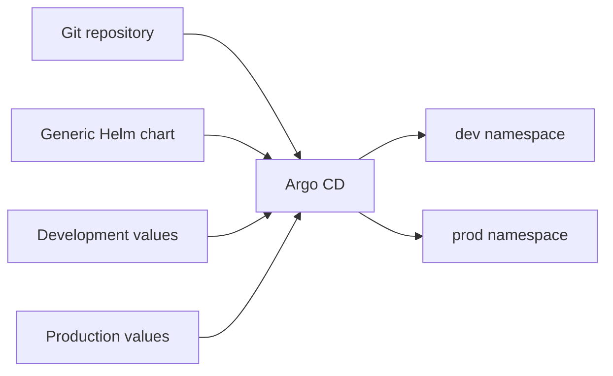

# Argo CD and Helm Delivery Patterns

[](https://argo-cd.readthedocs.io/)
[](https://helm.sh/)
[](https://kubernetes.io/)
[](https://ahmed-el-mahdy.github.io/)

A compact GitOps reference showing how one Helm chart can deliver an API service to development and production through Argo CD.

## What This Repository Demonstrates

- A reusable microservice chart for Deployments, Services, HPA, Ingress, and Azure Key Vault CSI resources.
- Separate value files for development and production behavior.
- Automated drift correction in development and manual promotion in production.
- An app-of-apps bootstrap manifest for the checked-in service Applications.
- An ApplicationSet example that generates the same two implemented service/environment combinations.

## Delivery Model



Development enables automated prune and self-heal. Production deliberately leaves synchronization manual and uses higher replica, resource, HPA, TLS, and secret requirements.

## Implemented Scope

| Path | Purpose |
| --- | --- |
| `charts/microservice` | Generic Helm chart used by the service Applications |
| `apps/api-service/dev.yaml` | Automated development Application |
| `apps/api-service/prod.yaml` | Manual production Application |
| `apps/app-of-apps.yaml` | Root Application that discovers the checked-in child Applications |
| `environments/api-service` | Development and production value files |
| `applicationsets/all-services.yaml` | List-generator alternative for the two implemented targets |

## Render Before Syncing

Rendering locally catches chart errors without touching a cluster:

```bash
helm lint charts/microservice
helm template api-service-dev charts/microservice \
  --namespace dev \
  -f environments/api-service/values-dev.yaml

helm template api-service-prod charts/microservice \
  --namespace prod \
  -f environments/api-service/values-prod.yaml
```

## Bootstrap Argo CD

Prerequisites: an existing Kubernetes cluster, Argo CD installed in the `argocd` namespace, and any required NGINX Ingress, cert-manager, and Secrets Store CSI components.

```bash
kubectl apply -f apps/app-of-apps.yaml
argocd app list
```

Applying the root Application changes cluster state. Inspect the repository URL, namespaces, image repositories, tenant IDs, Key Vault names, ingress hosts, and TLS issuers first.

## Promotion Flow

1. CI publishes an immutable image tag.
2. The target environment value file is updated in Git.
3. Argo CD detects the desired-state change.
4. Development reconciles automatically.
5. Production waits for an explicit review and sync.

## Security and Operations Notes

- Replace placeholder tenant IDs, vault names, registry names, and hostnames.
- Pin image tags to immutable versions or digests before production use.
- Keep production sync manual or protect it with an approved promotion workflow.
- Restrict Argo CD projects, destinations, and repository credentials using least privilege.
- Add notifications, policy checks, and rollback runbooks for a complete operating model.

## Status

This repository is a focused GitOps pattern library. The committed examples cover one API service in development and production; additional services and environments should be added only with matching value files and validation.
